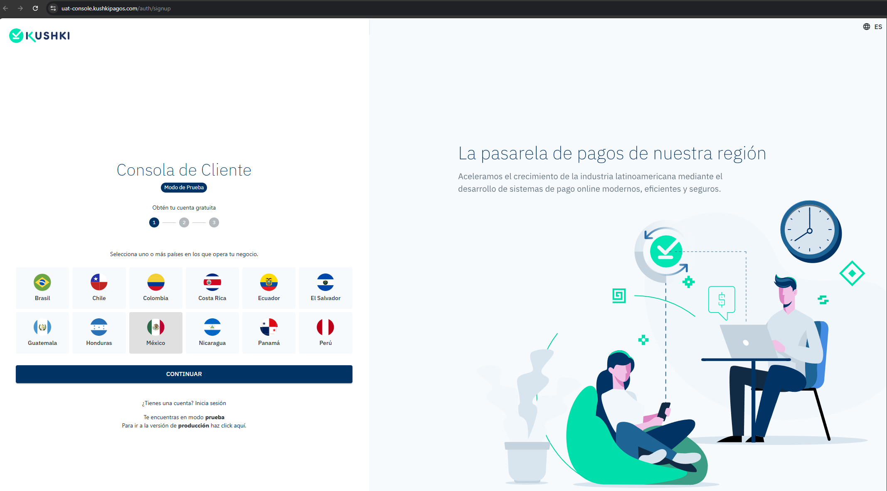
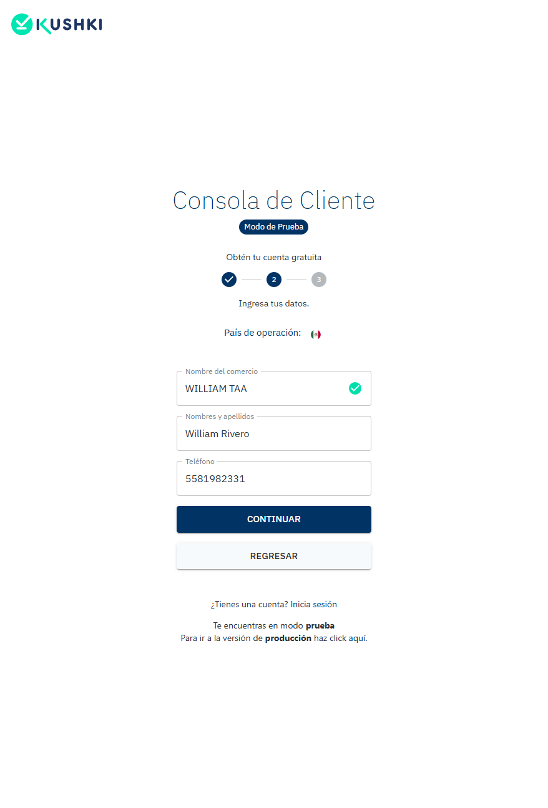
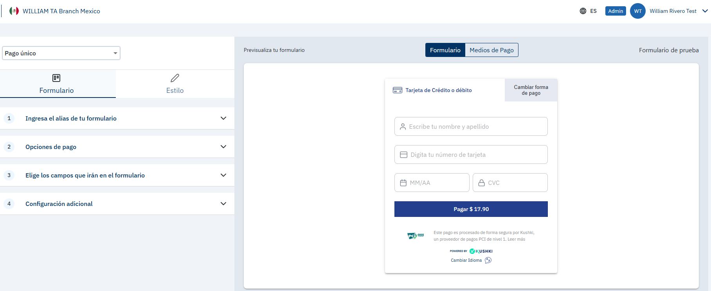
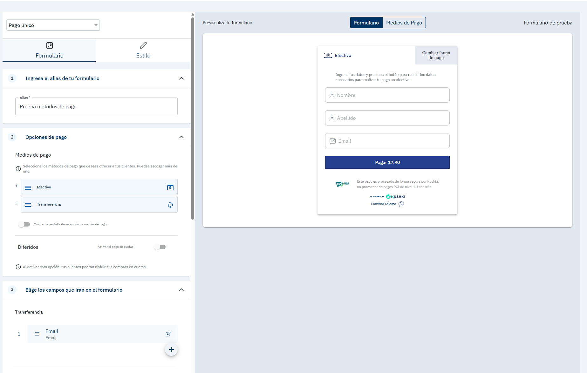
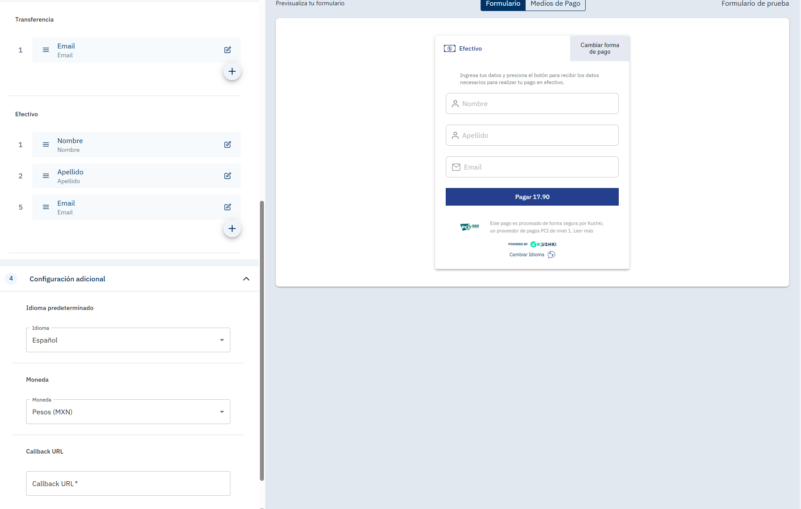
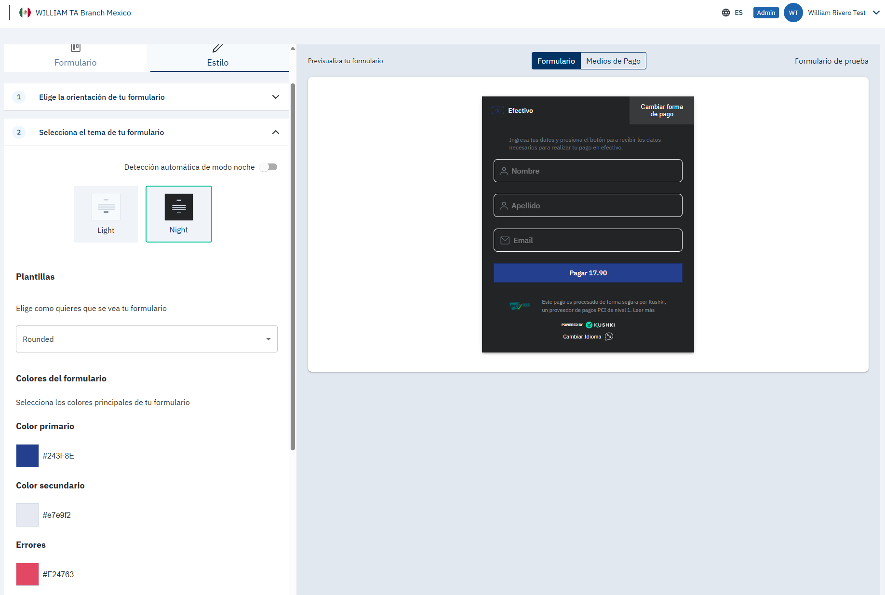
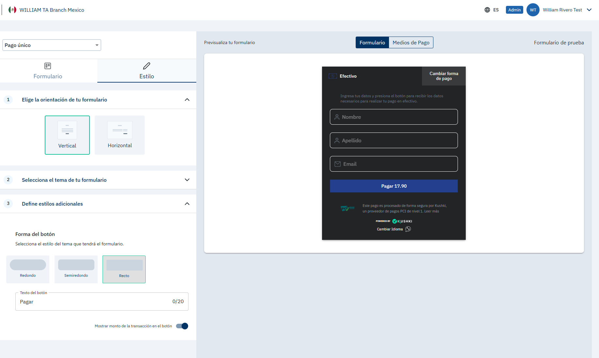
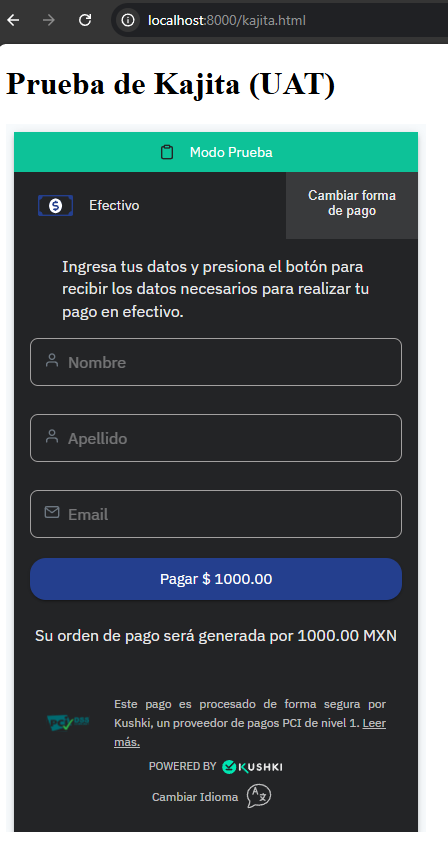

# Creación de la Kajita   

- **Objetivo:** Creación de la Kajita para cobro único con tarjeta.
- **Fecha:** 11/10/2026
- **Ambiente:** UAT, cuenta de México

**Qué hice:**
1. Creación de la cuenta por medio del Link incluido en el documento de mi prueba tecnica. Onboarding básico, sencillo y rápido. En 3 pasos te piden información, Pais, Nombre del comercio, Nombres y apellidos, teléfono, Nombre de usuario y un email. Posterior te llega un correo electronico para confirmar la creación de la cuenta y te deja acceder a la Consola para poder cambiar tu contraseña y darte acceso total como admin a la consola de pruebas.
1. LLegar a la dirección de la creación de la Kajita en la consola en:Configuración->Integraciones->Kajita->Crear un nuevo formulario de acuerdo a la guía proporcionada. 
2. Revisión de los menús y submenús, se puede agregar Alias para reconocer el nombre de la kajita en la lista de formularios creados.
3. Tiene opciones de pago, efectivo y transferencia. Tarjetas no aparece. Cada opción hace aparecer una opción extra en otro submenú para elegir los campos que irán en el formulario de acuerdo a la opción de pago, dando opciones predeterminadas para cada campo y una opción de texto, para cualquier dato extra que querramos anexar.
4. Como configuración adicional, tenemos opciones como el idioma en el que aparecerá el formulario en predeterminado. Teniendo como opciones Español, Inglés y Portugues. Moneda, sin opción al cambio y una URL a forma de Callback, de esta manera los clientes que paguen con esa Kajita, serán redireccionados a esa URL.
5. Tiene un apartado de estilo para mover la apariencia del forumlario, horizontal o verticalmente, así pueda encajar mejor tú página web. Paleta de colores y cambios de estilo de letra y presentación de los espacios de formulario además de poder cambiar la forma del botón y lo que tiene escrito el botón, en este caso "Pagar". También cuenta con una opción para que aparezca o no el monto de cobro en el botón.
6. Desplegué el botón ya configurado dentro de un localhost para poder visualizarlo y confirmar que no puedo transaccionar con tarjeta por ese medio.

**Evidencia:** 

**Problemas encontrados y acciones tomadas:** 
No poder probar el formulario Kajita como menciona la prueba técnica, para cargos unicos con tarjeta. 

Se comentó la situación al correo electronico que se tiene en comunicación con Kushki, se decidió documentar el error para validación posterior.

**Observaciones para el feedback:** 
En mi cuenta de UAT (México) la Kajita no ofrece la opción de tarjeta. Mi hipótesis es que las cuentas nuevas de prueba no traen la tarjeta habilitada. Sugiero que la prueba indique cómo activarla o que las cuentas la incluyan por defecto.