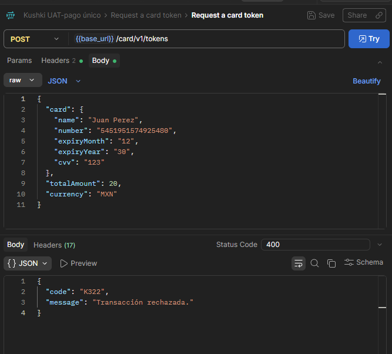
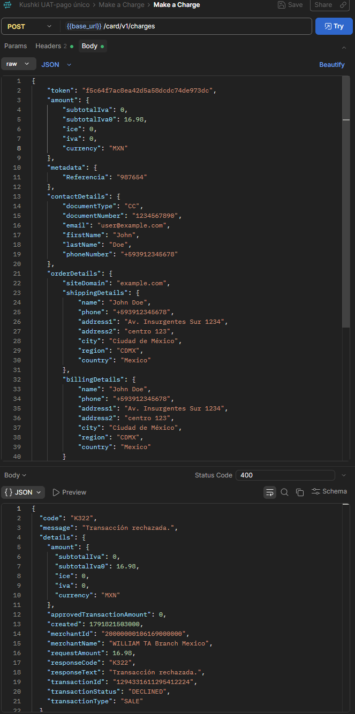
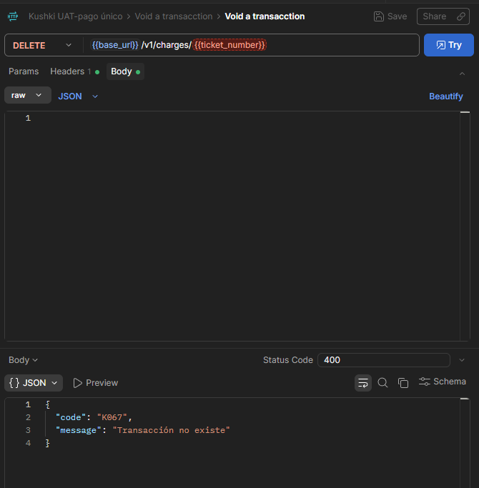
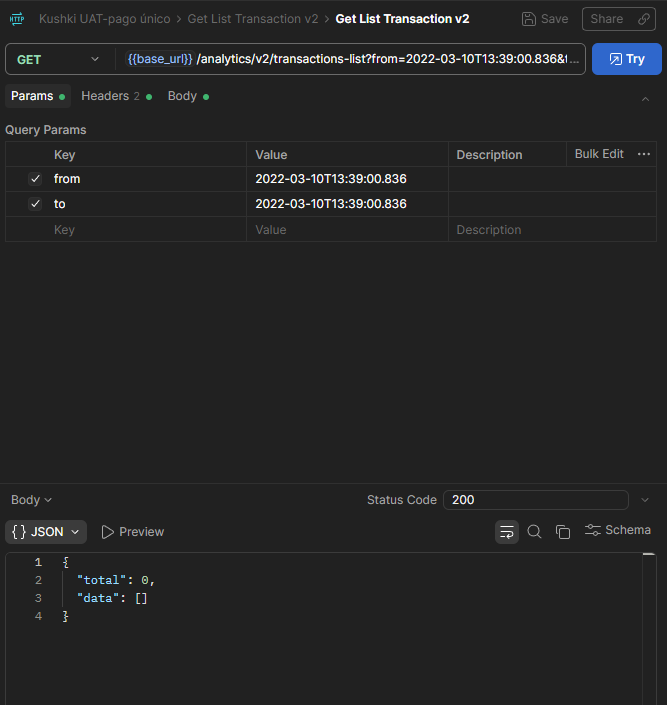
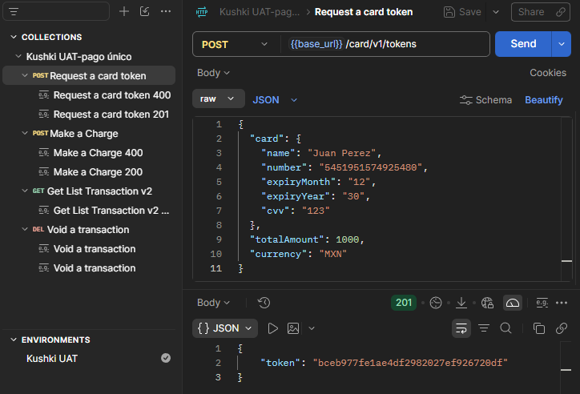
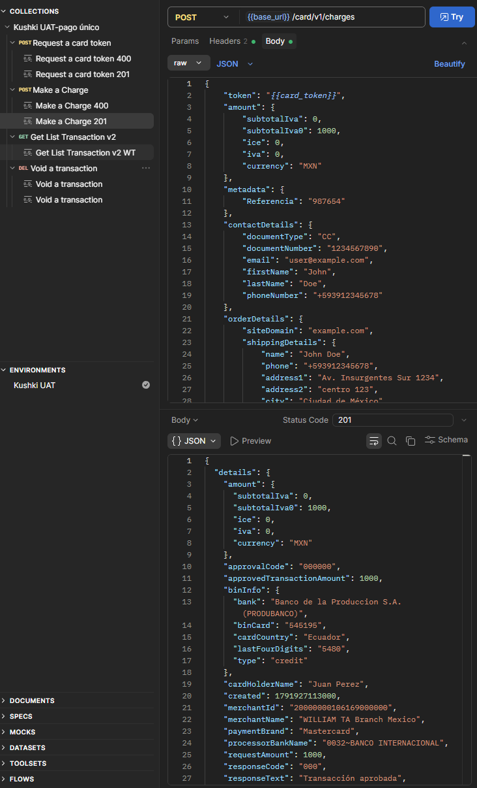
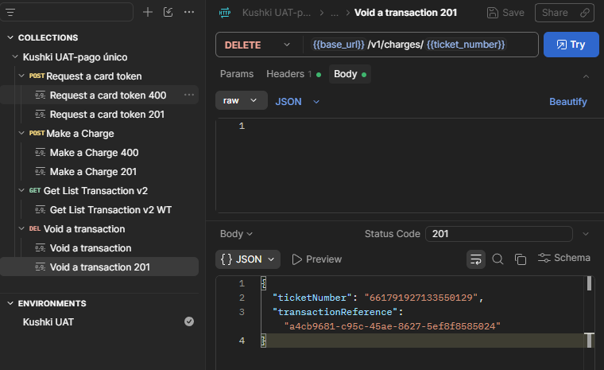
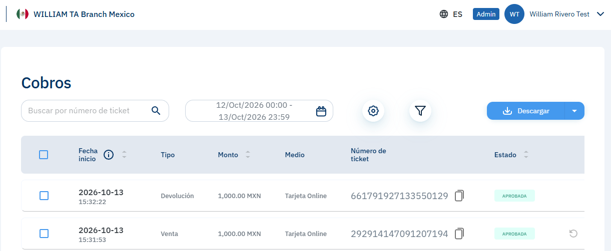
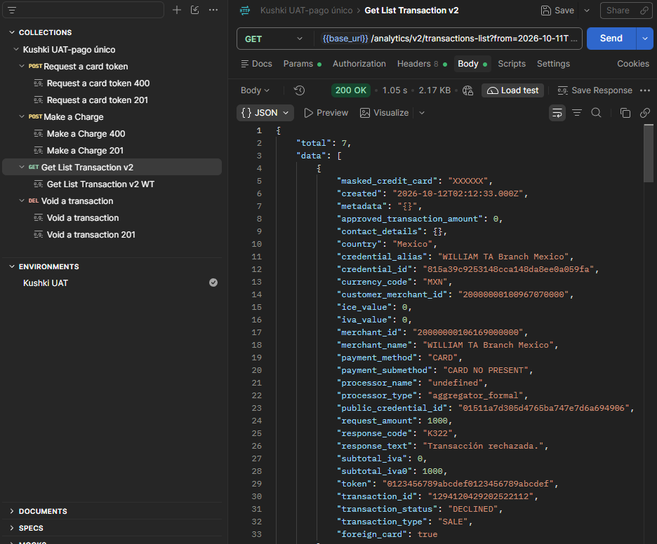

# Pruebas en entorno API con Postman

- **Objetivo:** Probar los servicios API via Postman.
- **Fecha:** 11/10/2026
- **Ambiente:** UAT, cuenta de México

**Qué hice:**
1. Integré una colección de request en Postman para la prueba de endpoints tales como /tokens, /charge, /analytics/v2. Esto con la finalidad de replicar el flujo completo de pagos únicos con tarjeta de crédito.

2. Se realizó request para obtener un token mediante API, pero se rechazó con un codigo K322, se infiere que la cuenta UAT no tiene activo el método de pago con tarjetas, por lo que este y los request posteriores no tendrán un resultado positivo, pero se encontrarán funcionando correctamente, en cuanto se active el método de tarjetas, en caso de que este sea el problema, los request deben funcionar correctamente.

**Evidencia:** 

3. Se realizó request para hacer un cargo mediante el token obtenido previamente guardandolo en una variable {{card_token}}. No se puede testear aún porque no se recibe el token, se ocupó un token de la documentación para simular, se obtuvo comunicación con la API y un rechazo.

**Evidencia:** 

4. Se realizó request para hacer un void al cargo previamente creado, guardando en la variable "ticket number" el dato necesario para hacer el void. Al no tener transacción anterior, se regresa un error "K067" la transacción no existe.

**Evidencia:** 

5. Se realizó request para obtener la lista de transacciones. Dado que la cuenta no tiene transacciones, regresó una lista vacia, pero se verificó que hubo comunicación con la API sin errores en la petición. 

**Evidencia:** 

**Problemas encontrados y acciones tomadas**
Se encontró código de rechazo "K322" al tratar de tokenizar tarjetas por medio de API, lo comuniqué con el equipo de Kushki para recibir ayuda y se documentó el error. Se dejan todos los ambientes preparados para realizar las pruebas pertinentes cuando se tenga respuesta de Kushki.

**Observaciones para el feedback:** 
El código de error K322 devuelve un mensaje genérico. Sería de gran utilidad para el desarrollador que la API proporcione un detalle descriptivo más claro en el cuerpo de la respuesta (por ejemplo: 'Merchant/Credential not enabled for Card payments in UAT'), reduciendo el tiempo de diagnóstico.

Se recomienda incluir en la documentación pública un listado de tokens de prueba activos permanentemente para entornos de Sandbox. Esto permitirá a los desarrolladores validar los flujos de `/charge` y `/void` de forma independiente a la activación manual de métodos de pago en el backend.

## Actualización

- **Fecha:** 13/10/2026

Se pidió ayuda al equipo de Kushki, que activó el método de pago con tarjeta en la cuenta UAT. Con eso se repitieron las pruebas y el flujo completo con tarjeta funcionó.

### Evidencia

**Request a card token (201)**

**Make a charge (201)** · ticketNumber: `292914147091207194`

**Void a transaction (201)** · ticketNumber: `661791927133550129`

**Consola UAT:** muestran el cobro y su anulación con los mismos números de ticket.

**Get transactions list (201)**

