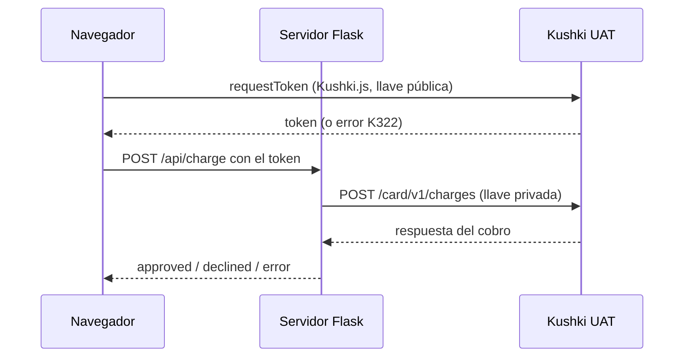
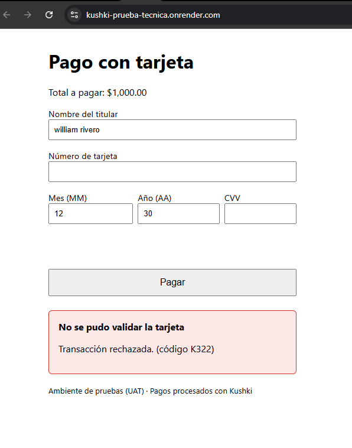
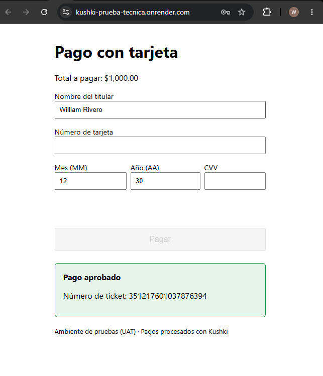
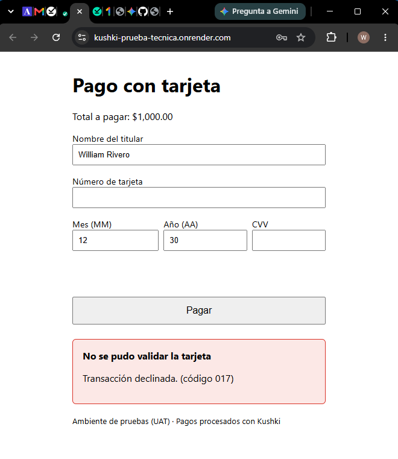
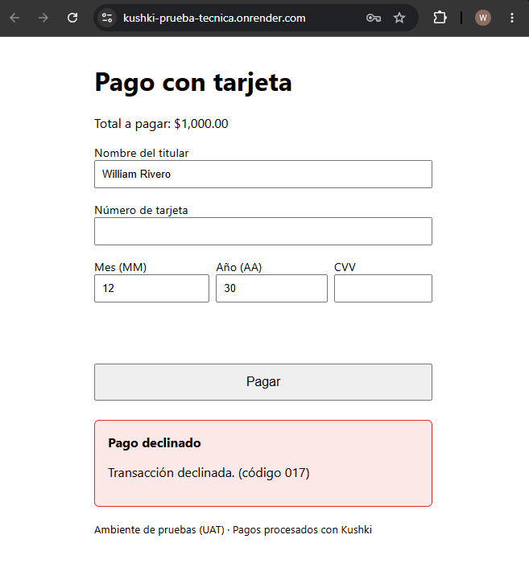

## Bonus, Despliegue de Forumlario de pago en hosting publico.

**Fecha:** 11/10/2026
**Ambiente:** UAT, cuenta de México

**Objetivo:** Desplegar un formulario de tarjetas que cumpla con los siguientes objetivos.
1. Request a card token. Usar la librería Kushki.js para obtener el token en el frontend.
2. Make a charge (Debe usarse el API).
3. Mostrar el resultado de la operación en pantalla (Deben soportarse
transacciones declinadas y aprobadas).

**Problemas encontrados y acciones tomadas:**
Se encontró código de rechazo "K322" al tratar de tokenizar tarjetas por medio de API, lo comuniqué con el equipo de Kushki para recibir ayuda y se documentó el error. Se dejan todos los ambientes preparados para realizar las pruebas pertinentes cuando se tenga respuesta de Kushki.

**Evidencia:** 

- **Fecha:** 13/10/2026

El equipo de Kushki ayudó a activar el método de pago con tarjeta, por lo cual se repitieron las pruebas en los ambientes ya preparados, con éxito en las pruebas requeridas en el apartado de *Objetivo*.

## Tarjetas de prueba utilizadas

Tarjetas oficiales del ambiente UAT de Kushki (México). En todas se usó una fecha de vencimiento futura y un CVV cualquiera.

| Escenario | Tarjeta |
|---|---|
| Aprobada | `5451951574925480` |
| Declinada al pedir el token | `4574441215190335` |
| Declinada al cobrar | `4349003000047015` |

### Evidencia

**Pago aprobado**

**Tarjeta declinada al pedir el token**

**Tarjeta declinada al cobrar**

**URL probada:** https://kushki-prueba-tecnica.onrender.com