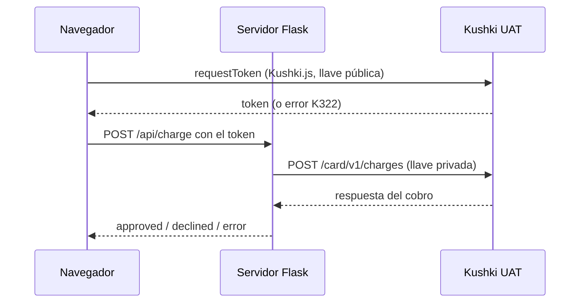

## Bonus, Despliegue de Forumlario de pago en hosting publico.

**Fecha y hora:** 11/10/2026
**Ambiente:** UAT, cuenta de México

**Objetivo:** Desplegar un formulario de tarjetas que cumpla con los siguientes objetivos.
1. Request a card token. Usar la librería Kushki.js para obtener el token en el frontend.
2. Make a charge (Debe usarse el API).
3. Mostrar el resultado de la operación en pantalla (Deben soportarse
transacciones declinadas y aprobadas).

**Problemas encontrados y acciones tomadas**
Se encontró código de rechazo "K322" al tratar de tokenizar tarjetas por medio de API, lo comuniqué con el equipo de Kushki para recibir ayuda y se documentó el error. Se dejan todos los ambientes preparados para realizar las pruebas pertinentes cuando se tenga respuesta de Kushki.

**Evidencia:** 

**URL del formulario** (https://kushki-prueba-tecnica.onrender.com/)